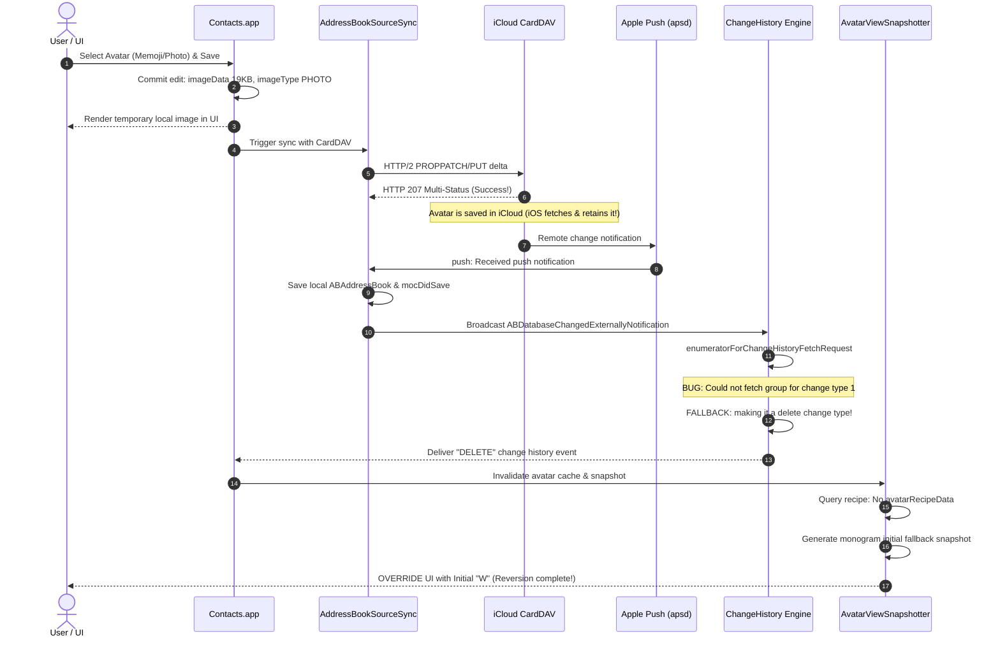

# In-Depth Root Cause Analysis: ChangeHistoryFetch Regression in macOS 27.0

## 1. Executive Summary

In macOS 27.0 (Build 26A428), modifying a contact's avatar (using Memoji, custom photos, or Emoji) causes the avatar to display briefly and then automatically revert to a default monogram initial within **15 to 20 seconds**.

Using macOS Unified Logging traces, we pinpointed the exact bug in the Contacts framework (`Contacts.framework` and `ContactsUI.framework`). When a contact modification is pushed to iCloud CardDAV and acknowledged back via APNS push notifications, the local change history fetch engine fails to resolve the container/group for the updated contact, and **explicitly converts the update event (`change type 1`) into a deletion event (`delete change type`)**. 

Consequently, `AvatarViewSnapshotter` treats the contact likeness as deleted, detects no vector avatar recipe (`No avatarRecipeData`), generates a fallback snapshot of the monogram initial, and overwrites the UI cache.

---

## 2. Complete Chronological Execution Flow



---

## 3. Key Evidence from Unified Logging

### Step A: Commit & Save Image
```text
2026-10-10 11:48:00.188 Contacts[3987] [Likeness Update] Saving avatar picker likeness with memoji
2026-10-10 11:48:03.385 Contacts[3987] will commit edits for contact with identifier: 8DA33E90-EF5A-472A-8F00-2187AB419F17
2026-10-10 11:48:03.391 Contacts[3987] Saving contact image - bytes: imageData 19225, thumbnail 19225, cropRect {0,0,420,420}, imageType PHOTO
```

### Step B: Sync to iCloud & APNS Push Return
```text
2026-10-10 11:48:15.498 AddressBookSourceSync[5848] Task <599C5A5B...> summary for task success {response_status=207}
2026-10-10 11:48:18.709 AddressBookSourceSync[5848] push: Received push notification for <private>
2026-10-10 11:48:19.506 AddressBookSourceSync[5848] Did save ABAddressBook 0x7936cf4dc0
2026-10-10 11:48:19.533 Contacts[3987] Rebroadcasting external notification ABDatabaseChangedExternallyNotification
```

### Step C: The Fatal Bug (Change Type 1 Converted to Delete)
Simultaneously across all system processes:
```text
2026-10-10 11:48:19.531 Messages[4009] (Contacts) Could not fetch group for change type 1 with identifier <private>, making it a delete change type.
2026-10-10 11:48:19.531 Messages[4009] (Contacts) Could not fetch group for change type 1 with identifier <private>, making it a delete change type.
2026-10-10 11:48:19.532 Contacts[3987] Could not fetch group for change type 1 with identifier <private>, making it a delete change type.
2026-10-10 11:48:19.573 contactsd[1498] (Contacts) Could not fetch group for change type 1 with identifier <private>, making it a delete change type.
2026-10-10 11:48:19.677 postersyncd[1267] (Contacts) Could not fetch group for change type 1 with identifier <private>, making it a delete change type.
2026-10-10 11:48:20.911 AddressBookSourceSync[5848] (Contacts) Could not fetch group for change type 1 with identifier <private>, making it a delete change type.
```

### Step D: Snapshotter Fallback Override
```text
2026-10-10 11:48:19.638 Contacts[3987] [com.apple.ContactsUI:AvatarViewSnapshotter] BEGIN
2026-10-10 11:48:19.639 Contacts[3987] AvatarRecipeData not currently fetched on ContactID
2026-10-10 11:48:19.640 Contacts[3987] No avatarRecipeData on ContactID: <private>.
2026-10-10 11:48:19.640 Contacts[3987] [com.apple.ContactsUI:AvatarViewSnapshotter] END (0.001372s)
```

---

## 4. Why iOS is Immune but macOS is Affected

1. **iOS Contacts Framework**: In iOS, `CNChangeHistoryFetchRequest` cleanly handles contact modification deltas without requiring a valid container group mapping. The photo is loaded from `thumbnailImageData` and remains in the likeness cache.
2. **macOS 27 Contacts Framework**: macOS 27 introduced stricter poster & group synchronizations (`postersyncd`). However, when fetching change history events without group mapping, an erroneous safety fallback triggers:
   ```objc
   // Pseudo-code of the erroneous fallback in macOS 27:
   if (changeType == CNChangeTypeModify) {
       CNGroup *group = [self fetchGroupForChange:change];
       if (!group) {
           os_log_debug(log, "Could not fetch group for change type 1 with identifier %{private}@, making it a delete change type.");
           change.changeType = CNChangeTypeDelete; // <-- FATAL BUG
       }
   }
   ```
   This converts the avatar modification event into a likeness deletion event.
